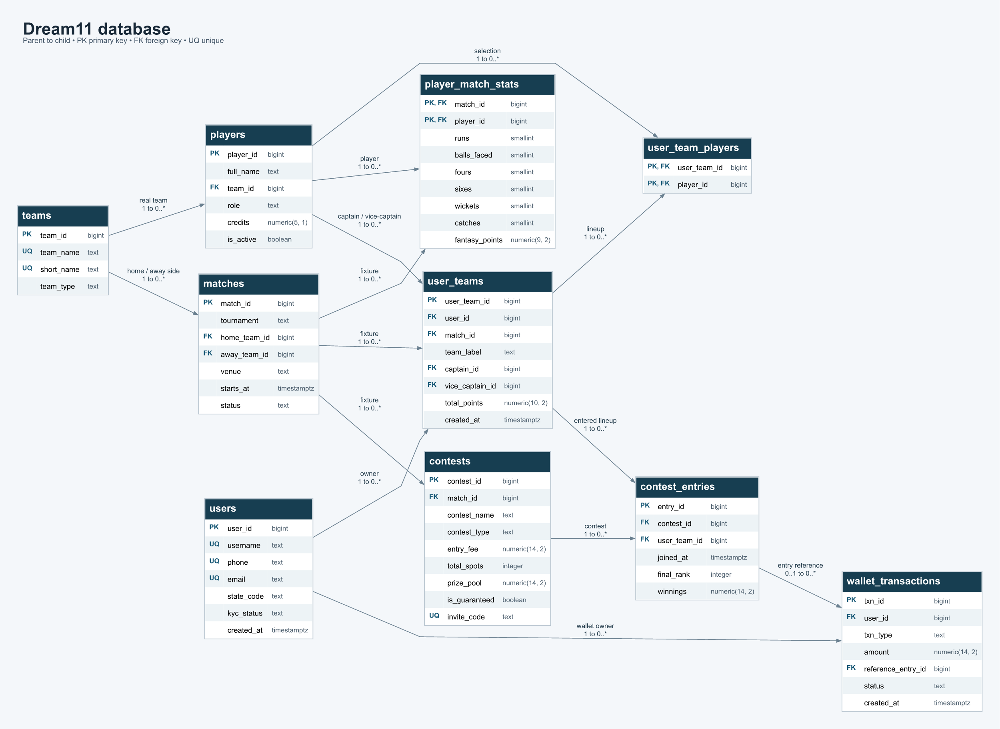
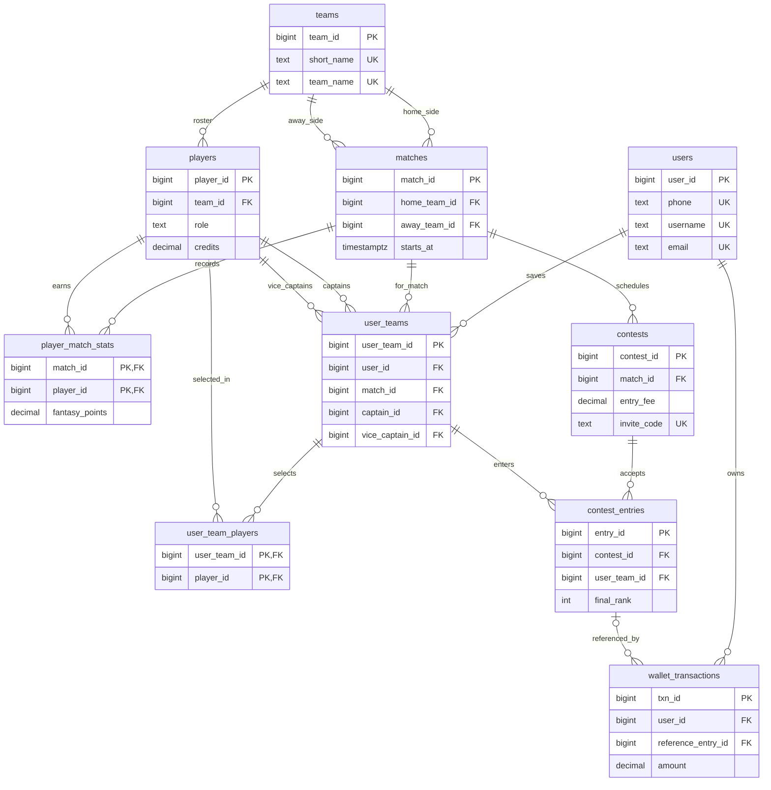

# Dream11 schema design

The ten CSV files define the table and column names. The loader uses `psql`'s `\copy` so it can read the files from the project directory. Parents are loaded before their children, then `ANALYZE` collects statistics for the baseline.

## Data dictionary

`PK` means primary key, `FK` means foreign key and `UQ` means unique. Columns are required unless marked nullable. Identity columns accept the IDs from the export and can allocate new IDs after the load.

| Table and column | PostgreSQL type | Constraint and reason |
| --- | --- | --- |
| `teams.team_id` | `bigint` | Identity PK for the real team. |
| `teams.team_name` | `text` | UQ team name. |
| `teams.short_name` | `text` | UQ abbreviation with two to five uppercase letters. |
| `teams.team_type` | `text` | Franchise or international team. |
| `players.player_id` | `bigint` | Identity PK for the player. |
| `players.full_name` | `text` | Name shown in the player pool. |
| `players.team_id` | `bigint` | FK to the real team. |
| `players.role` | `text` | `WK`, `BAT`, `AR` or `BOWL`. |
| `players.credits` | `numeric(5,1)` | Positive exact credit cost, bounded by the 100-credit budget. |
| `players.is_active` | `boolean` | Whether the player is available for selection. |
| `matches.match_id` | `bigint` | Identity PK for the fixture. |
| `matches.tournament` | `text` | Name of the series or tournament. |
| `matches.home_team_id`, `matches.away_team_id` | `bigint` | Two FKs to `teams`. The sides must differ. |
| `matches.venue` | `text` | Venue label as exported. |
| `matches.starts_at` | `timestamptz` | Scheduled start with the source offset interpreted. |
| `matches.status` | `text` | Upcoming, live, completed or abandoned. |
| `player_match_stats.match_id`, `player_match_stats.player_id` | `bigint` | FKs to `matches` and `players`. Together they are the PK for one performance per fixture. |
| `player_match_stats.runs`, `player_match_stats.balls_faced` | `smallint` | Nonnegative counts. |
| `player_match_stats.fours`, `player_match_stats.sixes`, `player_match_stats.catches` | `smallint` | Nonnegative counts. |
| `player_match_stats.wickets` | `smallint` | Whole number from 0 to 10. |
| `player_match_stats.fantasy_points` | `numeric(9,2)` | Published score, stored with decimal precision. |
| `users.user_id` | `bigint` | Identity PK for the account. |
| `users.username` | `text` | UQ, with letters, numbers and underscores. |
| `users.phone` | `text` | UQ 10-digit login identifier. Text preserves leading zeroes. |
| `users.email` | `text` | Nullable, UQ when entered. The export has accounts with phone only. |
| `users.state_code` | `text` | Two uppercase letters used by compliance queries. |
| `users.kyc_status` | `text` | Pending, rejected or verified. |
| `users.created_at` | `timestamptz` | Account creation time. |
| `user_teams.user_team_id` | `bigint` | Identity PK for a saved fantasy lineup. |
| `user_teams.user_id`, `user_teams.match_id` | `bigint` | FKs to the owner and fixture. Part of the alternate key for saved lineups. |
| `user_teams.team_label` | `text` | `T` followed by a positive integer. UQ per user and match. |
| `user_teams.captain_id`, `user_teams.vice_captain_id` | `bigint` | FKs to two different players. |
| `user_teams.total_points` | `numeric(10,2)` | Nullable until a score has been recorded. |
| `user_teams.created_at` | `timestamptz` | Time the lineup was saved. |
| `user_team_players.user_team_id`, `user_team_players.player_id` | `bigint` | FKs to a saved lineup and player. Together they prevent duplicate selections. |
| `contests.contest_id` | `bigint` | Identity PK for the contest. |
| `contests.match_id` | `bigint` | FK to the contest's fixture. |
| `contests.contest_name` | `text` | Display title. Titles can repeat in different fixtures. |
| `contests.contest_type` | `text` | Mega, small, private or head-to-head. |
| `contests.entry_fee`, `contests.prize_pool` | `numeric(14,2)` | Nonnegative exact money amounts. |
| `contests.total_spots` | `integer` | Positive capacity. A head-to-head contest has two spots. |
| `contests.is_guaranteed` | `boolean` | Whether the prize pool is guaranteed. |
| `contests.invite_code` | `text` | Nullable for public contests. A private contest has a unique uppercase alphanumeric code. |
| `contest_entries.entry_id` | `bigint` | Identity PK for one entry. |
| `contest_entries.contest_id`, `contest_entries.user_team_id` | `bigint` | FKs to a contest and lineup. UQ together to prevent duplicate entries and support W02. |
| `contest_entries.joined_at` | `timestamptz` | Time the team entered the contest. |
| `contest_entries.final_rank` | `integer` | Positive rank if published. Nullable until then. |
| `contest_entries.winnings` | `numeric(14,2)` | Nonnegative payout amount. Defaults to zero for a new entry. |
| `wallet_transactions.txn_id` | `bigint` | Identity PK for a ledger event. |
| `wallet_transactions.user_id` | `bigint` | FK to the wallet owner. |
| `wallet_transactions.txn_type` | `text` | Allowed ledger event. The type tells the wallet how to apply the amount. |
| `wallet_transactions.amount` | `numeric(14,2)` | Positive exact money amount. |
| `wallet_transactions.reference_entry_id` | `bigint` | FK to an entry. Required for entry fees, refunds and winnings. Nullable for other events. |
| `wallet_transactions.status` | `text` | Pending, failed or successful. |
| `wallet_transactions.created_at` | `timestamptz` | Ledger event time. |

Foreign keys use `ON DELETE RESTRICT` for fixtures, users, players, contests and financial records to retain history. `user_team_players.user_team_id` uses `ON DELETE CASCADE` because those selections belong to the lineup being removed. The baseline has the indexes generated by PK and unique constraints, including the login phone and the unique contest-entry pair. The verification query found zero standalone indexes.

## Entity relationships

## Functional dependencies and normal forms

| Table | Determinants in the schema |
| --- | --- |
| `teams` | `team_id`, `short_name` and `team_name` each identify a team and determine its type. |
| `players` | `player_id` determines the player's name, team, role, credit cost and active status. |
| `matches` | `match_id` determines the sides, tournament, venue, start and status. |
| `player_match_stats` | `(match_id, player_id)` determines the performance counts and published score. |
| `users` | `user_id`, `username` and `phone` are candidate keys. A supplied email identifies an account. |
| `user_teams` | `user_team_id` and `(user_id, match_id, team_label)` each determine captaincy, points and creation time. |
| `user_team_players` | `(user_team_id, player_id)` is a pure junction key. |
| `contests` | `contest_id` determines the match and contest configuration. An invite code identifies a private contest when supplied. |
| `contest_entries` | `entry_id` and `(contest_id, user_team_id)` each determine the entry time, rank and winnings. |
| `wallet_transactions` | `txn_id` determines the owner, type, amount, reference, status and time. Several events can reference one entry. |

Under these dependencies, non-key attributes depend on a full candidate key and the tables meet 3NF and BCNF. Three fields are worth calling out. `player_match_stats.fantasy_points` retains the score from the scoring engine. `user_teams.total_points` is a stored total that W04 recalculates from the lineup and captain multipliers. `contests.prize_pool` stores the advertised prize, which depends on the contest configuration and can differ from fees times capacity.

## Load and integrity results

The row counts below matched the export after running both SQL scripts on PostgreSQL 18.6. The schema has 31 `CHECK` constraints.

| Table | Expected and loaded |
| --- | ---: |
| `teams` | 18 |
| `players` | 450 |
| `matches` | 212 |
| `player_match_stats` | 4,444 |
| `users` | 50,000 |
| `user_teams` | 39,975 |
| `user_team_players` | 439,925 |
| `contests` | 2,544 |
| `contest_entries` | 42,746 |
| `wallet_transactions` | 118,343 |

| Check on loaded seed data | Violations |
| --- | ---: |
| Count selected players per lineup and check for exactly 11 | 200 |
| Join lineup players to the fixture to check that they belong to either side | 0 |
| Sum credits per lineup and check the 100-credit budget | 1,000 |
| Count selections per side and check the maximum of seven | 5,221 |
| Check that each lineup contains its captain and vice-captain | 0 |
| Compare lineup creation time with match start | 0 |
| Confirm that the entered lineup and its contest belong to the same match | 0 |
| Count successful `ENTRY_FEE` events per paid entry and check for exactly one | 192 |

The roster and wallet findings are kept in the database for the audit workload. The number of players, sum of credits and number of players from either side are checks across multiple selection rows. A contest-entry audit also needs to compare the entry and wallet tables. These rules are checked after loading; a production write flow could validate them inside its transaction.
